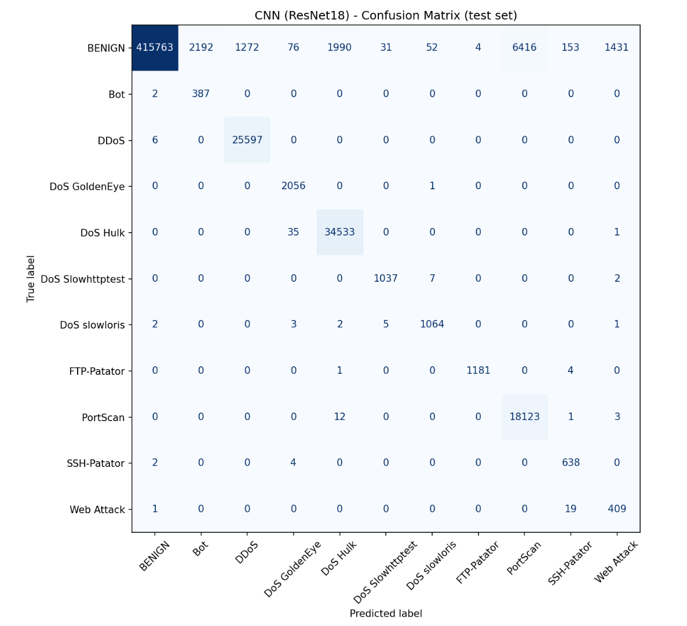
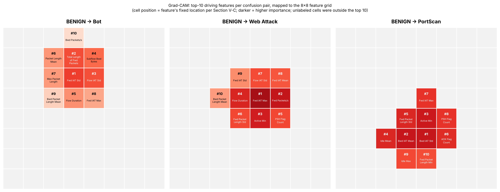
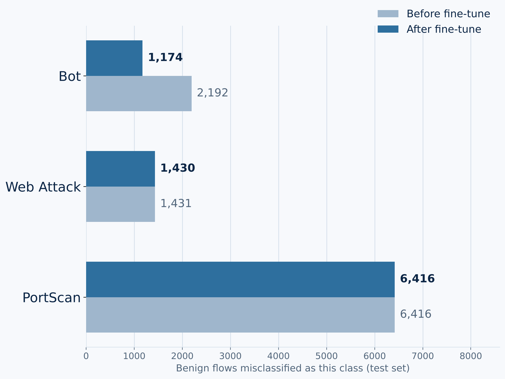

# BDAPP — Explainable Network Intrusion Detection via Flow-to-Image Encoding

Course project for **BDAPP (Big Data Analysis and Prediction Project)**, Sejong University — AI Convergence College, Dept. of AI Data Science.

Supervised classification of known network attack categories from the CIC-IDS2017 dataset, using a flow-to-image encoding + CNN (ResNet-18, transfer learning), with a Random Forest baseline, Grad-CAM explainability, a Grad-CAM-informed class-weight fine-tune, fidelity/stability validation of the Grad-CAM rankings, and a retrieval-augmented generation (RAG) layer that grounds each prediction in the MITRE ATT&CK knowledge base.

The full report (methodology, results, discussion, and a pipeline diagram) is in [`BDAPP_Final_Report.docx`](./BDAPP_Final_Report.docx).

> **Scope note:** this is supervised classification of *known* attack categories. It is explicitly **not** zero-day / anomaly detection.

## Results

The CNN reached a macro-averaged F1-score of 0.84 (0.85 after the fine-tune below), with recall ≥0.95 on every class — it misses almost nothing. The real weakness was precision on the rare classes, caused by benign traffic leaking into them:



Grad-CAM traced this to timing-based features (inter-arrival time, idle/active periods) driving all three benign confusions:



That ranking was then validated, not just visualized: a feature-masking fidelity check (script 13, following Udurume et al., *Sci. Rep.* 2026) zeroes the top-10 ranked features and re-evaluates the real checkpoint. The predictions flip **98.9%** of the time for Web Attack and **90.1%** for PortScan — but only **15.6%** for Bot, with the rankings themselves stable across bootstrap resamples (mean Jaccard overlap 0.79–1.00 across 5 resamples).

That split matches a targeted fine-tune tested beforehand: raising BENIGN's class weight (×2.5) cut Bot's benign-confusion count by 46% — but left Web Attack and PortScan completely unchanged, confirming their errors are a genuine feature overlap rather than a fixable class-weighting artifact:



Full per-class metrics, the RAG/MITRE ATT&CK retrieval table, and the full discussion of limitations are in [`BDAPP_Final_Report.docx`](./BDAPP_Final_Report.docx).

## Pipeline overview

```
CICIDS2017 raw flows
   -> cleaning & leakage-aware dedup (1-2)
   -> EDA (3)
   -> stratified train/test split (4)
   -> undersampling of BENIGN, train only (5)
   -> flow-to-image encoding, 8x8 grid (7)
   -> Random Forest baseline (6)  |  CNN: ResNet-18 (8)
   -> per-class evaluation
   -> Grad-CAM explainability (10)
   -> class-weight fine-tune, informed by Grad-CAM (11)
   -> fidelity & stability validation of the Grad-CAM rankings (13)
   -> RAG: MITRE ATT&CK technique retrieval (9)
   -> final report
```

(Script 12, `12_feature_selection_analysis.py`, is a read-only side analysis of the correlated feature clusters found in step 3 — see its own docstring and the table below.)

## Setup

```bash
python3 -m venv .venv
source .venv/bin/activate
python -m pip install --upgrade pip
pip install -r requirements.txt
```

Scripts 8, 10, 11, and 13 (CNN training, Grad-CAM, the fine-tune, and its fidelity/stability validation) are CPU-runnable but much faster on a GPU. The `notebooks/` folder has Colab versions of the heavy steps that load the dataset/checkpoint from Google Drive instead of a local path — see [Notebooks](#notebooks) below.

## Dataset

[CIC-IDS2017](https://www.unb.ca/cic/datasets/ids-2017.html) (Canadian Institute for Cybersecurity, UNB) — `MachineLearningCSV` version (pre-extracted flow features via CICFlowMeter, one CSV per day/segment).

Download `MachineLearningCSV.zip` from the [CIC download page](https://cicresearch.ca/CICDataset/CIC-IDS-2017/) and unzip it into:

```
data/MachineLearningCVE/
```

The 8 daily CSV files are not committed to this repository (see `.gitignore`) — several hundred MB, and the license terms are to cite the dataset, not to redistribute it.

## Pipeline scripts

Scripts in `scripts/` are numbered in the order they must run — each one reads the output of a previous step from `data/processed/` (or `models/`, `data/processed/reports/`). `config.py` and `flow_image_dataset.py` are shared modules imported by the numbered scripts, not run directly — Python module names can't start with a digit, so a couple of small helpers (e.g. `build_model()`) are duplicated across scripts rather than imported from one another.

| # | Script | What it does |
|---|---|---|
| 1 | `1_data_exploration.py` | First pass over the 8 raw CSVs: shape, dtypes, memory usage, null/duplicate counts, per-file class distribution. Used to decide what the cleaning step needs to fix. |
| 2 | `2_data_cleaning.py` | Cleans and merges the 8 CSVs into one dataset: strips column-name whitespace, converts `Infinity` to `NaN`, drops rows with NaN, drops duplicate rows (~9% of the raw data), fixes the corrupted Web Attack label encoding and groups the 3 subtypes into one `Web Attack` class, excludes `Heartbleed`/`Infiltration` (too few samples for a meaningful split), drops constant and duplicate columns, verifies all feature columns are numeric, and asserts zero remaining NaN/Infinity before saving. Output: `data/processed/cicids2017_clean.parquet`. |
| 3 | `3_eda_report.py` | Exploratory analysis on the cleaned data: class distribution plot (log scale), per-feature `describe()`, correlation heatmap, flags near-constant features and highly correlated feature pairs, and prints a draft summary paragraph for the written report. Output: `data/processed/eda/`. |
| 4 | `4_train_test_split.py` | Stratified 80/20 train/test split by `Label`, fixed random seed. The test set is never touched again — it keeps the real, imbalanced distribution for honest evaluation. Output: `data/processed/train.parquet`, `data/processed/test.parquet`. |
| 5 | `5_undersample_train.py` | Downsamples `BENIGN` in the training set only; every other class is left untouched. Output: `data/processed/train_undersampled.parquet`. |
| 6 | `6_train_baseline_rf.py` | Trains a Random Forest baseline (`class_weight='balanced'`) on the undersampled train set, evaluates per-class precision/recall/F1 and a confusion matrix on the untouched test set. Its feature importances also decide the grid layout used in step 7. Output: `models/rf_baseline.joblib`, `data/processed/reports/`. |
| 7 | `7_flow_to_image_encoding.py` | Encodes each flow into a small square grid for the CNN: pads the feature count up to the next perfect square, orders features by descending RF importance (from step 6) so neighboring grid cells are meaningfully related, fits a per-feature min-max scaler on train only, and stores compact `grid_size x grid_size` uint8 arrays — not pre-rendered 224×224 images; the nearest-neighbor upscale to ResNet18's input size happens lazily at training time (`flow_image_dataset.py`), never bilinear/bicubic, so no values are invented between features and Grad-CAM cells stay crisp. Output: `data/processed/flow_images/`. |
| 8 | `8_train_cnn.py` | Fine-tunes an ImageNet-pretrained ResNet-18 on the flow-image grids, with class-weighted loss, a stratified 90/10 train/val split for early stopping on validation macro-F1, and per-epoch CSV logging. Output: `models/cnn_resnet18_best.pt`, `data/processed/reports/cnn_*`. |
| 9 | `9_rag_attack_context.py` | RAG layer: retrieves the most relevant MITRE ATT&CK technique for each predicted attack class via semantic search (`sentence-transformers`, `all-MiniLM-L6-v2`) over the full ATT&CK Enterprise matrix, then has a local LLM (Qwen2.5-3B-Instruct) turn the retrieved technique text into an analyst-facing explanation, grounded and cited by technique ID — not generated freely from the LLM's own (possibly hallucinated) knowledge. `BENIGN` is excluded, since there is no attack to explain. Output: `data/processed/reports/rag_attack_context.csv`. |
| 10 | `10_gradcam.py` | Diagnostic Grad-CAM pass over the trained CNN checkpoint: for the three worst BENIGN→attack confusions found in step 8's evaluation, samples real misclassified test flows, runs Grad-CAM targeted at the *wrong* predicted class, reduces the native 224×224 heatmap back to the original 8×8 grid by exact block-averaging (never resizing), and ranks which original features drove each confusion. Output: `data/processed/reports/gradcam_feature_importance_summary.csv`, example heatmap overlays. |
| 11 | `11_finetune_cnn_benign_weight.py` | Continues training from step 8's checkpoint with BENIGN's class weight raised by a fixed multiplier — the single change motivated directly by step 10's findings — and re-evaluates the three confusion pairs to check whether the fix is real or just shifts the error elsewhere. Output: `models/cnn_resnet18_finetuned_benign_weight.pt`, `data/processed/reports/cnn_finetune_*`. |
| 12 | `12_feature_selection_analysis.py` | Read-only analysis (does not retrain anything): clusters the 63 features by absolute correlation of 0.95 or higher (found in step 3), and within each cluster keeps the one feature with the highest Random Forest importance (step 6) — a justified feature-selection pass reported in the discussion, not re-run through the pipeline given the time available for the course. |
| 13 | `13_gradcam_fidelity_stability.py` | Validates step 10's rankings instead of leaving them as an unverified correlation: **fidelity** (feature-masking/deletion test — zeroes the top-k ranked features and measures the flip/reclaim rate and confidence drop, per confusion pair and globally across the test set) and **stability** (5 bootstrap resamples of the misclassified flows, fresh Grad-CAM on each, mean pairwise Jaccard overlap of the top-10 features), following Udurume et al. (Sci. Rep., 2026). Runs on the *same* original checkpoint step 10 used. Output: `data/processed/reports/gradcam_fidelity_stability.csv`. |

Run them in order:

```bash
python scripts/1_data_exploration.py
python scripts/2_data_cleaning.py
python scripts/3_eda_report.py
python scripts/4_train_test_split.py
python scripts/5_undersample_train.py
python scripts/6_train_baseline_rf.py
python scripts/7_flow_to_image_encoding.py
python scripts/8_train_cnn.py
python scripts/9_rag_attack_context.py
python scripts/10_gradcam.py
python scripts/11_finetune_cnn_benign_weight.py
python scripts/12_feature_selection_analysis.py
python scripts/13_gradcam_fidelity_stability.py
```

Steps 8, 10, 11, and 13 need a GPU to run in reasonable time; see [Notebooks](#notebooks).

## Notebooks

`notebooks/` has Colab versions of the steps that benefit most from a GPU — same logic as the corresponding numbered script, but reading/writing Google Drive paths instead of local ones:

| Notebook | Mirrors | Use for |
|---|---|---|
| `BDAPP_train_cnn_colab.ipynb` | `8_train_cnn.py` | Training the CNN checkpoint. |
| `BDAPP_gradcam_colab.ipynb` | `10_gradcam.py` | Running the Grad-CAM diagnostic pass. |
| `BDAPP_finetune_cnn_colab.ipynb` | `11_finetune_cnn_benign_weight.py` | Running the class-weight fine-tune. |

(Script 13 has no dedicated notebook; running `python scripts/13_gradcam_fidelity_stability.py` from a Colab cell, with Drive mounted and `config.py`'s paths pointed at it, reuses the same logic.)

## Class balancing strategy

Given the severe imbalance (BENIGN is ~83% of the cleaned data; the smallest class, Bot, is ~0.08%), imbalance is addressed **only on the training set, after the train/test split** (never on test, to keep evaluation honest; never before the split, to avoid train/test leakage):

1. **Class weights** — reweights the loss so errors on minority classes count more (`class_weight='balanced'` in both the Random Forest and the CNN's loss function).
2. **Undersampling of BENIGN** — random downsampling of the majority class only, since the benign flows carry a lot of redundant information.
3. **Grad-CAM-informed re-weighting** — after diagnosing which features drove the model's benign-vs-attack confusions (step 10), BENIGN's class weight is further raised by a fixed multiplier (step 11) and the effect is re-measured per class, rather than tuned blindly.

## Known dataset limitations

- `Heartbleed` (11 samples) and `Infiltration` (36 samples) are excluded from the cleaned dataset: too few samples for a meaningful train/test split, and not related in traffic pattern to any other class.
- Even after undersampling, class imbalance remains significant — model evaluation always reports per-class metrics, never accuracy alone.
- The system is a closed-set classifier and cannot recognize attack types absent from the training data; all results are offline, on a single dataset collected in 2017.

## Project structure

```
BDAPP_project/
├── data/
│   ├── MachineLearningCVE/     # raw CSVs (not committed, see .gitignore)
│   └── processed/              # cleaned/split/undersampled parquet files, flow images, EDA plots, reports/
├── models/                     # trained model artifacts (baseline RF, original and fine-tuned CNN checkpoints)
├── notebooks/                  # Colab versions of the GPU-heavy steps (see table above)
├── scripts/                    # numbered pipeline scripts (see table above) + config.py, flow_image_dataset.py
├── BDAPP_Final_Report.docx     # full written report
├── requirements.txt
└── README.md
```
